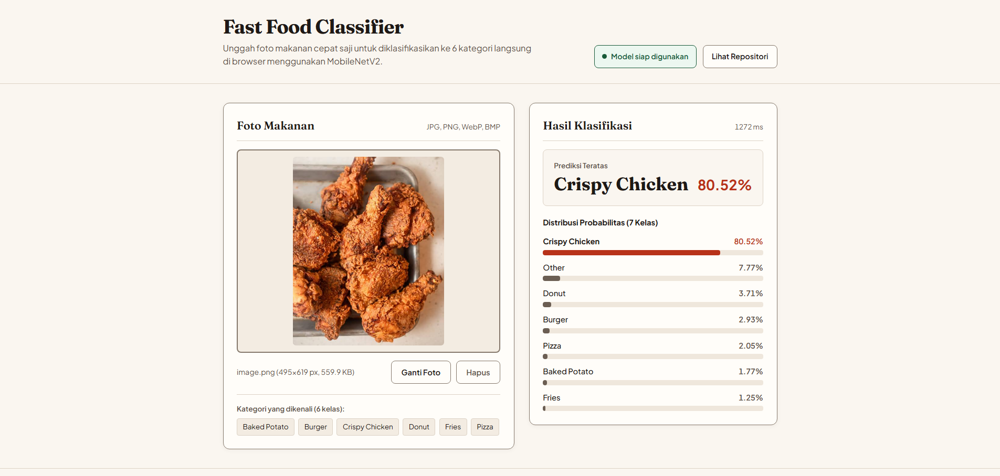
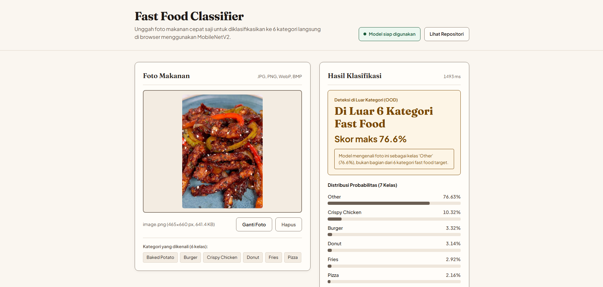

# Fast Food Image Classification

Sistem klasifikasi gambar 6 kategori makanan cepat saji berbasis Convolutional Neural Network (CNN) dengan transfer learning MobileNetV2, dilengkapi kelas _Out-of-Distribution_ (`Other`), _OOD Embedding Gate_, CLI TensorFlow Lite, dan antarmuka web client-side menggunakan TensorFlow.js.

## Demo Antarmuka Web

Link Demo: https://ilhamdwi22.github.io/fast-food-image-classification/

### 1. Pengujian Kategori Target (In-Distribution)

Pada gambar makanan yang termasuk dalam 6 kategori target, model mengenali objek sebagai **Crispy Chicken (80,52%)** dengan probabilitas kelas lain jauh di bawahnya (`Other` 7,77%, `Donut` 3,71%, `Burger` 2,93%).



### 2. Pengujian di Luar Kategori (Out-of-Distribution)

Pada foto hidangan di luar 6 kategori fast food, model mengklasifikasikannya ke kelas **Other (76,63%)** dan OOD Gate menampilkan status **Di Luar 6 Kategori Fast Food** agar sistem tidak memaksakan label fast food yang keliru.



## Ringkasan Proyek

Model dirancang untuk mengklasifikasikan 6 kategori makanan cepat saji sekaligus menolak gambar di luar domain secara eksplisit:

- **Kategori target (6 kelas):** `Baked Potato`, `Burger`, `Crispy Chicken`, `Donut`, `Fries`, `Pizza`
- **Deteksi di luar kategori (OOD):** Kelas ke-7 `Other` (_hard negatives_) yang dipadukan dengan _OOD Embedding Gate_ (kemiripan cosine 128-dim terhadap centroid kelas, ambang confidence, dan entropi)
- **Arsitektur:** Keras `Sequential` berbasis `MobileNetV2` (ImageNet, 2-stage fine-tuning) + custom head (`Conv2D`, `BatchNormalization`, `MaxPooling2D`, `GlobalAveragePooling2D`, `Dense`, `Dropout`)
- **Format ekspor:** TensorFlow SavedModel, TensorFlow Lite (`model.tflite` + `label.txt`), TensorFlow.js (`model.json` + `group1-shard1of1.bin`), dan konfigurasi inferensi bersama (`model_meta.json`)
- **Antarmuka web:** Halaman statis HTML, CSS, dan JavaScript yang menjalankan inferensi langsung di browser tanpa mengirim gambar ke server

## Dataset

Data pelatihan disusun dari dua sumber Kaggle dengan pembagian stratifikasi 80% Train, 10% Validation, dan 10% Test (`seed=42`):

1. **6 Kelas Target Fast Food** dari [`utkarshsaxenadn/fast-food-classification-dataset`](https://www.kaggle.com/datasets/utkarshsaxenadn/fast-food-classification-dataset) (`Fast Food Classification V2`): 12.000 gambar beresolusi non-uniform (2.000 gambar per kelas, 474 variasi resolusi unik).
2. **Kelas `Other` (Hard Negatives):** Gabungan 4 kelas sisa Fast Food V2 (`Hot Dog`, `Sandwich`, `Taco`, `Taquito`) dan kategori makanan non-fast-food dari [`trolukovich/food11-image-dataset`](https://www.kaggle.com/datasets/trolukovich/food11-image-dataset) (`Seafood`, `Meat`, `Rice`, `Soup`, `Noodles-Pasta`, `Vegetable-Fruit`).

Preprocessing menerapkan _center-square crop_, resize `224x224`, dan normalisasi MobileNetV2 ke rentang `[-1, 1]` (`(x / 127.5) - 1.0`). Augmentasi (`random_flip_left_right`, random crop/zoom, brightness, contrast, saturation) hanya diterapkan pada data training melalui pipeline `tf.data`.

## Arsitektur Model & Pelatihan

Model menggunakan Keras `Sequential` dengan backbone `MobileNetV2` (`input_shape=(224, 224, 3)`, `include_top=False`, `weights="imagenet"`):

1. `MobileNetV2` backbone
2. `Conv2D(128, 3x3, padding="same", use_bias=False)` (`head_conv`)
3. `BatchNormalization` (`head_bn`) + `ReLU` (`head_relu`)
4. `MaxPooling2D(2x2)` (`head_pool`)
5. `GlobalAveragePooling2D` (`embedding_gap`, vektor fitur 128-dim untuk OOD Gate)
6. `Dense(256, relu)` (`head_dense`) + `Dropout(0.4)` (`head_dropout`)
7. `Dense(7, softmax)` (`predictions`)

Konfigurasi pelatihan:

- **2-Stage Transfer Learning:** Stage 1 melatih head dengan backbone frozen (`Adam lr=1e-3`, 8 epoch), dilanjutkan Stage 2 fine-tuning 40 layer atas MobileNetV2 dengan seluruh `BatchNormalization` backbone tetap freeze (`Adam lr=3e-5`, hingga 12 epoch).
- **Loss & Callbacks:** `CategoricalCrossentropy(label_smoothing=0.1)`, `ModelCheckpoint(monitor="val_loss", save_best_only=True)`, `ReduceLROnPlateau`, `EarlyStopping`, dan `ThresholdCallback(target_acc=0.96)`.
- **Kalibrasi OOD:** Setelah pelatihan selesai, centroid L2-normalized 128-dim dihitung untuk setiap kelas fast food dari data training, dan ambang _cosine similarity_ dikalibrasi pada persentil ke-5 data validasi (`min_cosine_similarity = 0.6761` pada artefak saat ini).

## Artefak Model

Seluruh hasil ekspor tersimpan di folder `models/`:

| Format          | Lokasi                   | Berkas Utama                           |   Ukuran | Target Penggunaan              |
| :-------------- | :----------------------- | :------------------------------------- | -------: | :----------------------------- |
| SavedModel      | `models/saved_model/`    | `saved_model.pb`, `variables/`         | ~15,3 MB | Server / TensorFlow Serving    |
| TensorFlow Lite | `models/tflite/`         | `model.tflite`, `label.txt`            | ~3,84 MB | Mobile, edge, dan CLI lokal    |
| TensorFlow.js   | `models/tfjs_model/`     | `model.json`, `group1-shard1of1.bin`   | ~14,7 MB | Aplikasi web / browser         |
| Metadata & OOD  | `models/model_meta.json` | Konfigurasi skala, label, centroid OOD |   ~14 KB | Dibaca otomatis oleh Web & CLI |

## Struktur Direktori

```text
fast-food-image-classification/
├── .gitignore
├── README.md
├── requirements.txt
├── index.html                  # Antarmuka web klasifikasi gambar
├── notebook.ipynb              # Notebook pelatihan 2-stage, kalibrasi OOD, & ekspor model
├── assets/                     # Tangkapan layar demo untuk dokumentasi
├── web/
│   ├── styles.css              # Styling responsif antarmuka web
│   └── app.js                  # Unggah gambar, center-crop, inferensi TFJS, & OOD Gate
├── src/
│   ├── data_preparation.py     # Unduh dataset (+ kelas Other), audit resolusi, & split 80:10:10
│   ├── train.py                # Pipeline tf.data, 2-stage fine-tuning, kalibrasi OOD, & ekspor
│   └── inference.py            # CLI prediksi TFLite + pemeriksaan OOD berbasis model_meta.json
└── models/
    ├── model_meta.json         # Konfigurasi preprocessing, label, & ambang OOD
    ├── saved_model/            # Model format TensorFlow SavedModel
    ├── tflite/                 # Model TFLite teroptimasi + label.txt
    └── tfjs_model/             # Model format TensorFlow.js (model.json + shard .bin)
```

## Prasyarat & Instalasi

- Python 3.10 atau lebih baru
- Kredensial Kaggle aktif untuk `kagglehub` (hanya dibutuhkan saat mengunduh ulang dataset)
- GPU CUDA direkomendasikan bila menjalankan pelatihan ulang

Buat dan aktifkan virtual environment, lalu pasang dependensi:

```bash
python -m venv .venv
```

- **Windows (PowerShell):**
  ```powershell
  .\.venv\Scripts\Activate.ps1
  ```
- **Linux / macOS:**
  ```bash
  source .venv/bin/activate
  ```

```bash
pip install -r requirements.txt
```

## Cara Menjalankan

### 1. Antarmuka Web (TensorFlow.js)

Menjalankan antarmuka web secara lokal melalui HTTP server statis agar browser dapat memuat berkas model di `models/tfjs_model/`:

```bash
python -m http.server 8000
```

Buka `http://localhost:8000` di browser. Pengguna dapat mengunggah foto melalui tombol pilih berkas, _drag-and-drop_, atau `Ctrl+V`.

### 2. Inferensi CLI (TensorFlow Lite)

Menjalankan prediksi pada satu berkas gambar atau seluruh gambar dalam satu folder:

```bash
python src/inference.py path/to/sample_pizza.png
```

Opsi tambahan:

- `--top-k 3`: jumlah prediksi teratas yang ditampilkan (default `3`)
- `--model models/tflite/model.tflite`: path model TFLite kustom
- `--labels models/tflite/label.txt`: path file label kustom
- `--meta models/model_meta.json`: path metadata & konfigurasi OOD kustom
- `--json`: menampilkan output dalam format JSON

Contoh output CLI:

```text
Image: sample_pizza.png
  1. Pizza             81.93%
  2. Other              8.35%
  3. Donut              2.47%
```

Jika gambar terdeteksi di luar 6 kategori fast food, CLI akan menambahkan status `[OOD] Outside 6 fast food categories`.

### 3. Persiapan Dataset

Mengunduh dataset dari Kaggle via `kagglehub`, merakit 6 kelas fast food beserta kelas `Other`, memverifikasi resolusi citra, dan membagi data 80:10:10:

```bash
python src/data_preparation.py --raw-dir data/raw_dataset --split-dir data/dataset_split --seed 42
```

Gunakan `--source-dir` dan `--food11-dir` jika dataset sudah tersedia secara lokal, atau `--no-other` untuk melatih 6 kelas saja.

### 4. Pelatihan & Ekspor Model

Melatih model 2-stage, mengkalibrasi OOD Gate, menyimpan plot akurasi/loss, dan mengekspor seluruh artefak ke `models/`:

```bash
python src/train.py \
  --data-dir data/dataset_split \
  --models-dir models \
  --stage1-epochs 8 \
  --stage2-epochs 12 \
  --fine-tune-layers 40 \
  --batch-size 64 \
  --stage1-lr 0.001 \
  --stage2-lr 0.00003 \
  --label-smoothing 0.1 \
  --target-acc 0.96 \
  --plot-path training_history.png
```

Seluruh alur pelatihan dan ekspor yang sama juga tersedia dalam bentuk interaktif di [notebook.ipynb](notebook.ipynb).
